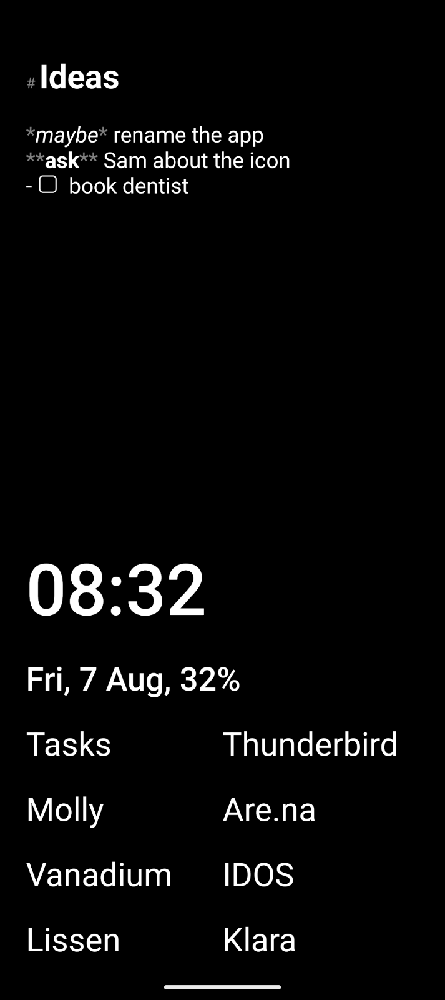
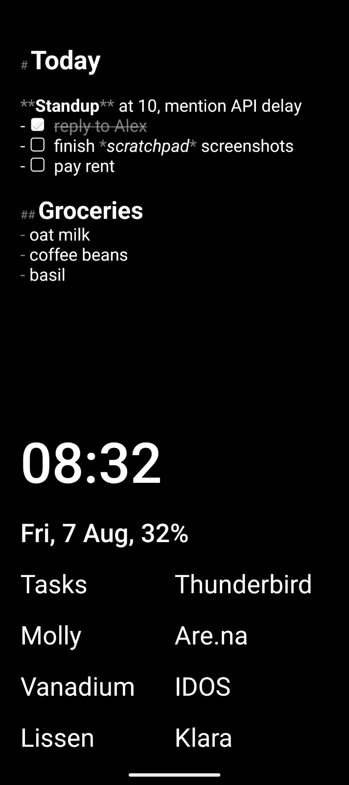

<h1> Scratchpad Launcher</h1>

**A minimal Android home screen that's also a piece of paper.**

Unlock your phone and you're already in your notes. No app to open, no widget to tap, no account.

The top half is a plain text box that's always there: write something down without opening an app, and it's still there after a reboot. The bottom half is a small, fixed list of apps. Nothing else.

  
  

## Why

Sometimes you just want to write something down and have it always visible, without opening any app. This is a fork of [Olauncher](https://github.com/tanujnotes/Olauncher), a minimal, ad-free Android launcher, with the app grid cut down and a persistent scratchpad put in its place.

It's for anyone who keeps a shopping list, a phone number, or today's three tasks in their head because opening a notes app feels like too much.

## Features

- **Always-visible scratchpad**: unlock your phone and start typing. Notes are saved as you type and survive reboots.
- **Light markdown**: `# headings`, `**bold**`, `*italic*`, `<u>underline</u>`, `~~strike~~`, `==highlight==`, `` `code` ``, `[links](url)`, `- lists` and `- [ ]` checkboxes you can tick with a tap. Formatting marks are hidden until you tap to edit. Lists nest with indentation, deeper headings fade, and the scratchpad font is selectable. An optional formatting toolbar above the keyboard is off by default (Settings → Formatting toolbar).
- **Type to launch**: swipe up, type a few letters, and the app opens as soon as there's only one match.
- **Sync as `scratchpad.md`**: optionally mirror the scratchpad into a folder, e.g. an Obsidian vault synced to your other devices. See [backup and restore](#backup-and-restore).
- **Small, fixed app list**: a handful of apps with no icons and no clutter. Rename, hide, and align them.
- **Gestures**: double tap to lock, swipe left/right to open apps, swipe down for notifications or search.
- **Readable**: separate text sizes for the scratchpad and the rest of the launcher, plus light and dark themes.
- **Works with** dual apps, work profiles and private space.

## Privacy

No accounts, no analytics, no ads, and no network calls except links you tap yourself. Scratchpad text is stored locally in its own preferences file and excluded from Android auto-backup, so it never leaves the device unless you turn on folder sync yourself.

The optional accessibility service is used only for double-tap-to-lock. It's off by default and collects nothing.

## Support the project

If Scratchpad Launcher is useful to you, **[give it a star ⭐](https://github.com/mstcgalis/scratchpad-launcher/stargazers)**. Once the repo has 35 stars it can be listed in [Obtainium's app directory](https://apps.obtainium.imranr.dev), making it easier for others to find.

Feedback, ideas and bug reports are welcome in [Issues](https://github.com/mstcgalis/scratchpad-launcher/issues) or by email at [daniel@dgalis.sk](mailto:daniel@dgalis.sk).

## Development

Single Gradle module, built with [`just`](https://github.com/casey/just): `just build`, `just test`, `just lint`, `just run` (install on a connected device), `just release VERSION`.

## Backup and restore

- **One-off file**: **Settings → Back up** saves everything to a file of your choosing (default `scratchpad-launcher-backup.json`): the note, home apps and their renames, hidden apps, drawer renames and all settings. **Restore** loads such a file (up to 1 MB) after asking you to confirm, replacing all of it. A plain text file (e.g. an older `scratchpad.md` backup) replaces just the note. The sync folder is not included, since its permission is tied to the device.
- **Continuous**: **Settings → Sync folder** keeps `scratchpad.md` in a folder up to date whenever you leave the launcher, and picks up edits made to that file from outside (Syncthing, Obsidian, etc.) within a few seconds. Long-press to stop syncing. If the scratchpad already has text when you pick a folder, it overwrites any `scratchpad.md` there; nothing is merged and the latest write wins.

## License

[GNU GPLv3](https://www.gnu.org/licenses/gpl-3.0.en.html), inherited from [Olauncher](https://github.com/tanujnotes/Olauncher) by [tanujnotes](https://github.com/tanujnotes). This fork builds on Olauncher v6.7.19.

Bundled clock fonts (Space Grotesk, Fraunces, Fredoka, Caveat) are © their respective Project Authors and licensed under the [SIL Open Font License 1.1](https://openfontlicense.org).
